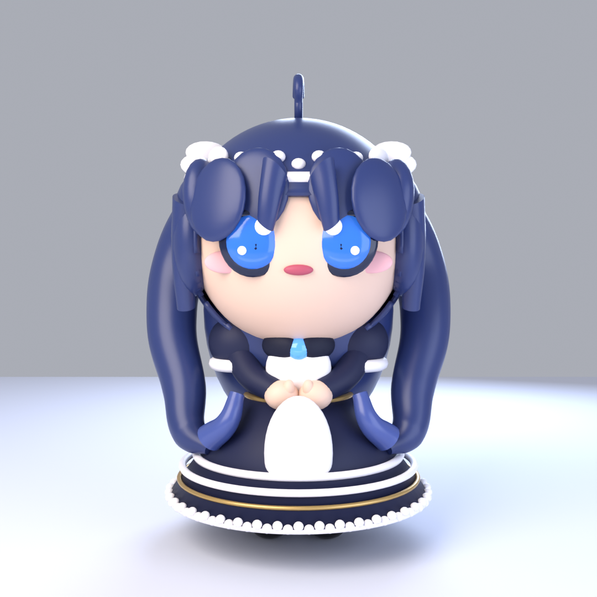
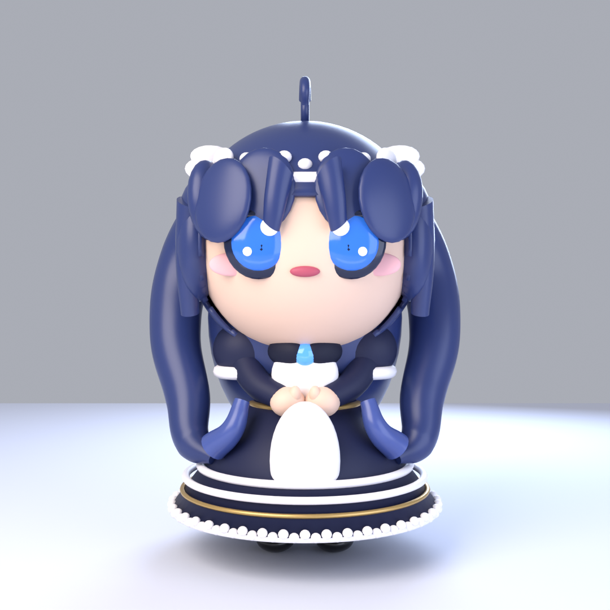

# 歪毛小女仆 · 3D

> 照着一张 Q 版立绘，用 **Blender 的 Python API（bpy）** 一行一行建出来的角色。
> **没有素材库、没有贴图文件、没有付费 3D 生成器**——全是程序化几何 + 纯色材质。

**👉 [在线转着看](https://qq26379101146.github.io/maid-3d/)**（模型全内联，断网也能开）

| | |
| --- | --- |
| 规格 | **99 个物体 / 56,806 面** |
| 尺寸 | 约 0.91 × 0.78 × 1.33 m（Q 版比例） |
| 格式 | glTF 2.0 二进制（`.glb`，3.9 MB） |
| Blender | 4.5.10 LTS |
| 渲染 | Cycles 64 采样 + denoise |





---

## 成品

| 文件 | 说明 |
| --- | --- |
| `docs/index.html` | **双击就能转着看**的自包含查看器（three.js + 模型全内联，4.7 MB，不联网、不需服务器） |
| `model/chibi_maid.glb` | glTF 2.0，可直接拖进任何 3D 软件 / three.js |
| `renders/hero.png` | 主图（1080²，Cycles 64 采样） |
| `renders/view_*.png` | 正面 / 3-4 侧 / 侧面 / 背面 |
| `share/chibi_maid_turn.gif` | 480px 循环 GIF，360° 转一圈 1.8 秒，微信/QQ 都能发 |
| `share/chibi_maid_turn.mp4` | H.264，画质最好 |
| `share/share_card.png` | 1080×1440 竖版分享卡 |

查看器：左键拖拽旋转、滚轮缩放、右键平移，底部有「正面 / 3-4 侧 / 侧面 / 背面 / 看脸 / 复位」和自动旋转开关。

> 为什么不直接双击 `.glb`：Windows 默认没给 glTF 关联任何查看器，双击只会弹「百度网盘 / 记事本 / 画图」那种不认识它的程序。网页查看器把 three.js 和模型全塞进一个 HTML，所以**离线也能开**，拷给别人也能直接看。

---

## 脚本

| 脚本 | 干什么 |
| --- | --- |
| `scripts/maid_lib.py` | 工具箱：材质调色板 + 球/柱/锥/环/方体/带条/蕾丝环/合并/报告 |
| `scripts/build_model.py` | 主建模：头 → 发壳 → 呆毛 → 头带 → 五官 → 身体 → 裙 → 腿鞋 → 挂到 `ChibiMaid_Root` |
| `scripts/setup_scene.py` | 世界色、地面、四盏面光（Key/Fill/Rim/Bounce）、正面相机、EEVEE/Cycles 渲染参数 |
| `scripts/export_model.py` | 存 .blend、导出 .glb、拍 5 张成品图（Cycles 64 采样） |
| `scripts/render_turntable.py` | 渲 36 帧转台 |
| `scripts/make_share.py` | 合成 GIF / MP4 / 分享卡 |
| `scripts/make_viewer.py` | 把 three.js + .glb 塞成一个自包含 HTML |

三个建模脚本都是幂等的：`build_model.py` 开头会清场，重复跑不会堆垃圾。

```python
# 重建：先开 Blender（它自己会 listen 127.0.0.1:9876），然后在 MCP 里跑
p = r".../scripts/build_model.py"
exec(compile(open(p, encoding="utf-8").read(), "build_model.py", "exec"), {"__name__": "__main__"})
# 再跑 setup_scene.py（重建世界/灯/相机），最后 export_model.py
```

---

## 关键做法（都是踩坑换来的）

### 1. 头发 = 球壳挖洞 + Solidify，不是一堆球堆的

`hair_shell()` 先建一个 UV 球，用 bmesh 按归一化坐标删掉脸那一片，再 Solidify 0.014 加厚度。
刘海不是单独摆几撮，而是把**开口的上沿做成波浪线**：

```python
rim = 0.290 + 0.055*cos(nx*9.5)
```

**波浪本身就是分股刘海。** 这是让「动漫头发」成立的决定性一步。

### 2. 发束用贝塞尔曲线 + 变半径 bevel，不用球串

`strand(name, control_pts, radii, ...)`：曲线逐点设 `bp.radius`，`bevel_depth=1.0`，转 MESH。

早先用球堆（`blob_chain`）时双马尾有严重「竹节 / 弹簧纹」，球-球交界出现环状凹槽。
换成 strand 后竹节纹消失，**面数还从 106,310 掉到 56,342**。

### 3. 发饰的半径必须跟着发壳走

头带一开始是 torus major 0.344 放在 z=1.032，而发壳在那个高度的截面半径只有
`sqrt(0.326² - dz²) ≈ 0.274`——于是白圈飘在头外、额前多一根横杠。
改成 major 0.288 / minor 0.018，荷叶边半径 0.272，才贴住。

### 4. 排查「脸上那块白板」（可复用到任何穿模 / 漏肉问题）

- **正面射线栅格**：`scene.ray_cast(depsgraph, Vector((x,-2.0,z)), Vector((0,1,0)))`，
  打印命中的对象名，得到一张正面轮廓 ASCII 图；
- **染色判别**：把皮肤材质临时改绿、世界背景改洋红再渲一张——
  白板跟着变绿，就证明是**露出来的额头皮肤**，而不是穿模或背景。

根因是发际线太高（rim 0.30+0.105cos → 世界 z 0.92~0.99），压低到 0.290+0.055cos 后解决。

### 5. 灯光在 EEVEE 和 Cycles 下不是一回事

同一套灯，EEVEE Next 渲出来发平、发暗；Cycles 直接过曝把脸打成死白。

最终定稿：Key 140 / Fill 50 / Rim 95 / Bounce 12（面积光，暖白-冷蓝），
Cycles 64 采样 + denoise + 曝光 -0.15，皮肤基色从 `#f6dccb` 压到 `#eccbb6`。

### 6. 看图别忘指定 target

`look()` 不传 `target=["ChibiMaid_Root"]` 会把 6 m 的地面一起框进去，角色小得看不清
——第一轮就是这么误判的。

### 7. GIF 几个坑

- **所有帧共用一套调色板**。逐帧各自量化会有闪烁，转起来像在抖。
  做法：把所有帧拼成长图求一次全局 palette，再逐帧 quantize。
- **Pillow 的 GIF duration 按 10ms 取整**。传 48 会被写成 40，要 50ms 就传 50。
- **背景必须透明底出图**（`film_transparent=True`）。一开始用世界背景，结果场景里的面光把「世界」也照亮了——右边比左边亮 90，贴到卡片上一条明显的方框边。
- **地面要隐藏**。转台里一块平灰地面最碍眼，而且阴影不跟着转，显得假。
- **分享卡底色要和渲染背景一致**（`#2E344C` 附近）。实测纯色背景是 `(46,52,76)`。

---

## 坑与注意

- 启动 Blender 必须在 Git Bash 里用 `cmd //c start "" blender.exe`，直接跑 exe 会阻塞终端。
- Blender 没开时 MCP 报 `Addon handshake failed: Connection to Blender lost: [WinError 10053]`，意思就是「Blender 没在跑」，不是插件坏了。
- 本机 Blender 的素材库与 3D 生成器全关（要用付费 key），所以这个模型是纯程序化几何。
- 交付图用 Cycles（900²/48 只要 14 秒，1080²/64 五张约 2 分钟）；EEVEE Next 只适合快速试形。
- Blender `-b` 会用**它自己的 cwd** 解析相对路径，脚本里的路径必须写绝对路径。

---

## 还能再做的

- 头带上的蝴蝶结目前是两侧各一朵；参考图额头正中还有一颗蓝宝石结（试过会挡脸，已删）。
- 呆毛现在是「两片」的形状，参考图是一根卷；可以再加一段 curl。
- 头发是实心壳，没做发丝细节；要更精致得用曲线头发或粒子毛发。
- 没有骨骼 / 绑定，也没有表情形态键。

---

<sub>由「大肥鱼」在自己家里的 Windows 机器上折腾出来 · 2026</sub>
